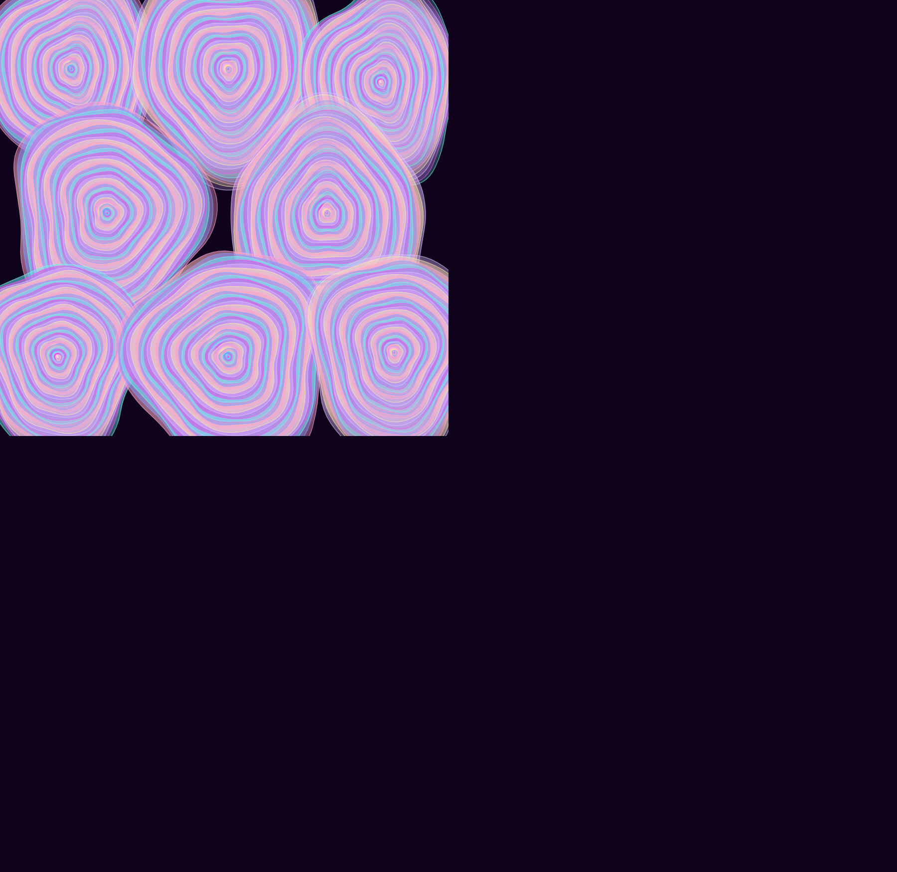
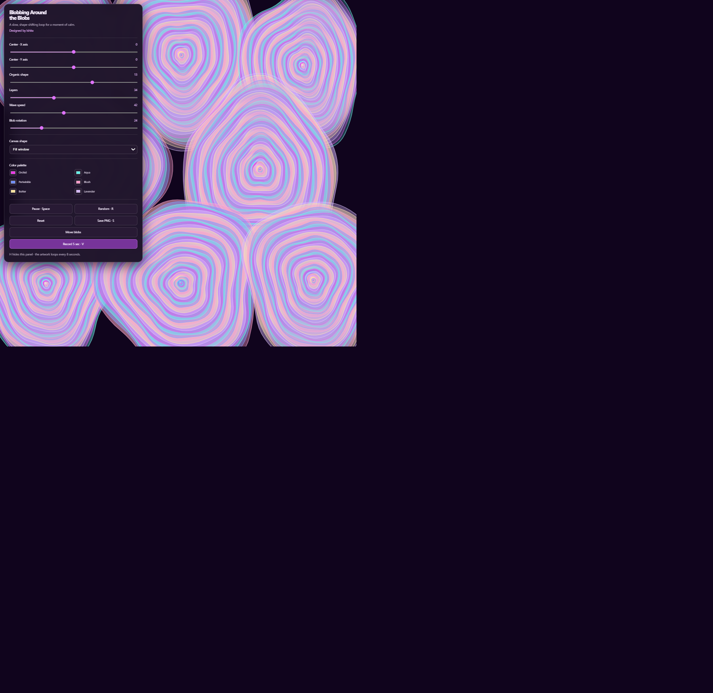

# Blobbing Around the Blobs

A single-file, interactive canvas animation for creating calm, looping blob artwork. Adjust the composition, move blobs into place, tune the motion, and export a still image or a short video.

## Run locally

Open `index.html` in a modern desktop browser. There is no build step, package installation, or server required.

## Controls

- **Center X / Y:** Shift the composition.
- **Organic shape:** Change the blobs from round to more fluid forms.
- **Layers:** Set the number of contour layers.
- **Wave speed:** Adjust the pace of the looping motion.
- **Blob rotation:** Change how much the shapes rotate.
- **Move blobs:** Drag a numbered blob to place it independently. Choose **Done moving blobs** to leave placement mode.
- **Color palette:** Change the six colors used by the artwork.
- **Canvas shape:** Choose window fill, 16:9, 1:1, or 9:16.
- **Reset:** Restore the default sliders, palette, and blob positions.

### Keyboard shortcuts

| Key | Action |
| --- | --- |
| `Space` | Pause or play |
| `R` | Randomize the sliders |
| `S` | Save a PNG |
| `V` | Record a 5-second video |
| `H` | Hide or show the controls |

Video export uses the MP4 or WebM format supported by the browser.

## Screenshots

## Project files

- `index.html` - complete application; HTML, CSS, and JavaScript are self-contained.
- `screenshots/` - project preview images for the repository README.

## Credits

Designed by Ishita.
